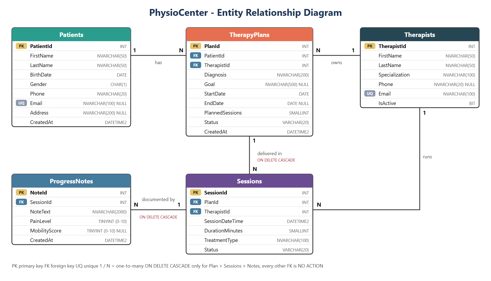
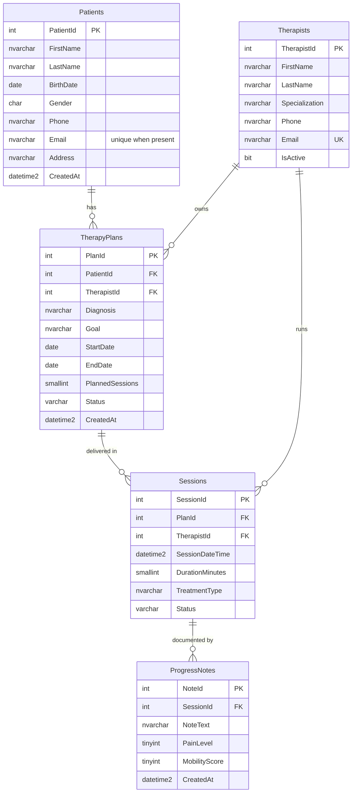

# Task 21 - Physiotherapy Center (database + backend API)

Database model for a physiotherapy center: **patients, therapy plans, sessions and progress notes**.
Created and hosted in a **Microsoft SQL Server 2022 instance running in a Docker container**.

* **Part 1 - database:** `sql/` and `scripts/` (sections 1-4 below).
* **Part 2 - backend API + service layer:** `PhysioCenter.Api/` and `PhysioCenter.Services/` (section 5 below).

## 1. Docker command (downloads and runs SQL Server)

```bash
docker run -e "ACCEPT_EULA=Y" -e "MSSQL_SA_PASSWORD=Physio_Strong123!" -p 1433:1433 -v physio_data:/var/opt/mssql --name physio-sql -d mcr.microsoft.com/mssql/server:2022-latest
```

* `docker run` downloads the image `mcr.microsoft.com/mssql/server:2022-latest` on first use and starts the container.
* `sa` password: `Physio_Strong123!` (SQL Server requires 8+ characters from 3 of: upper, lower, digit, symbol).
* `-v physio_data:/var/opt/mssql` keeps the data when the container is removed.
* Wait ~15-20 seconds for SQL Server to start (`docker logs physio-sql`).

## 2. Create the schema

### Option A - one command (PowerShell)

```powershell
powershell -ExecutionPolicy Bypass -File scripts\setup.ps1
```

It starts the container (if needed), waits for SQL Server, copies `sql\` into the container and runs all scripts in order.
Add `-Reset` to drop the database and rebuild it.

### Option B - manual

```powershell
docker cp sql physio-sql:/tmp
docker exec physio-sql /opt/mssql-tools18/bin/sqlcmd -S localhost -U sa -P "Physio_Strong123!" -C -b -I -i /tmp/sql/01_create_database.sql
docker exec physio-sql /opt/mssql-tools18/bin/sqlcmd -S localhost -U sa -P "Physio_Strong123!" -C -b -I -i /tmp/sql/02_create_tables.sql
docker exec physio-sql /opt/mssql-tools18/bin/sqlcmd -S localhost -U sa -P "Physio_Strong123!" -C -b -I -i /tmp/sql/03_create_indexes.sql
docker exec physio-sql /opt/mssql-tools18/bin/sqlcmd -S localhost -U sa -P "Physio_Strong123!" -C -b -I -i /tmp/sql/04_seed_data.sql
docker exec physio-sql /opt/mssql-tools18/bin/sqlcmd -S localhost -U sa -P "Physio_Strong123!" -C -b -I -i /tmp/sql/05_verify.sql
```

| Script | Purpose |
|---|---|
| `sql/00_reset.sql` | Optional: drops the database to start over |
| `sql/01_create_database.sql` | Creates the `PhysioCenter` database |
| `sql/02_create_tables.sql` | Tables, primary keys, foreign keys, unique / check / default constraints |
| `sql/03_create_indexes.sql` | Foreign key indexes, search indexes, filtered unique indexes |
| `sql/04_seed_data.sql` | Sample data (3 therapists, 5 patients, 5 plans, 16 sessions, 11 notes) |
| `sql/05_verify.sql` | Lists the created structure and runs PASS/FAIL constraint tests (all rolled back) |

Connect from any SQL client with: server `localhost,1433`, login `sa`, database `PhysioCenter`
(or open a shell: `docker exec -it physio-sql /opt/mssql-tools18/bin/sqlcmd -S localhost -U sa -P "Physio_Strong123!" -C -d PhysioCenter`).

## 3. Data model



Same model as a Mermaid diagram (renders on GitHub):



### Constraints

| Table | Rules |
|---|---|
| Patients | PK; `Gender IN ('M','F','O')`; birth date between 1900 and today; e-mail format check; **unique e-mail (filtered index, e-mail is optional)** |
| Therapists | PK; unique e-mail; e-mail format check; `IsActive` default 1 |
| TherapyPlans | PK; FK to Patients and Therapists; `EndDate >= StartDate`; `PlannedSessions > 0`; `Status IN ('Active','Completed','Cancelled','OnHold')`; defaults for Status and CreatedAt |
| Sessions | PK; FK to TherapyPlans (**ON DELETE CASCADE**) and Therapists; duration 5-240 min; `Status IN ('Scheduled','Completed','Cancelled','NoShow')`; **a therapist cannot have two non-cancelled sessions at the same start time (filtered unique index)** |
| ProgressNotes | PK; FK to Sessions (**ON DELETE CASCADE**); `PainLevel` 0-10; `MobilityScore` 0-10; note text must not be empty |

### Design decisions

* **Delete rules.** Deleting a plan removes its sessions and notes (they belong to the plan). Deleting a patient or therapist who still has plans or sessions is blocked, so medical history is not lost by mistake. Every table is reachable through only one cascade path, which avoids SQL Server's "multiple cascade paths" error.
* **Indexes.** Every foreign key column is indexed. Extra indexes support patient name search, session date search and a therapist's schedule. `IX_ProgressNotes_SessionId` includes `PainLevel`, `MobilityScore` and `CreatedAt` for progress queries.
* **Names are stored as `NVARCHAR`**, so Cyrillic data is supported. The sample data uses Latin names to avoid console encoding problems.

## 4. Start over / clean up

```powershell
powershell -ExecutionPolicy Bypass -File scripts\setup.ps1 -Reset   # rebuild only the database
docker rm -f physio-sql                                              # remove the container
docker volume rm physio_data                                         # also delete the stored data
```

If you recreate the container and the login fails, the old volume still holds the old `sa` password - remove the volume (`docker volume rm physio_data`) first.
If port 1433 is already used, change the mapping, e.g. `-p 14333:1433`.

---

## 5. Backend API and service layer

An ASP.NET Core Web API (.NET 8, controllers) that works with the `PhysioCenter` database, plus a separate project that is the **service layer**.
The database is created by the scripts in `sql/` - the API only maps it with Entity Framework Core, it does not create or migrate it.

### Solution structure

```
PhysioCenter.sln
├── PhysioCenter.Services/        <- SERVICE LAYER (class library)
│   ├── Entities/                    entity classes of the 5 tables
│   ├── Data/PhysioDbContext.cs      EF Core mapping of the existing database
│   ├── Dtos/                        request / response models + validation attributes
│   ├── Interfaces/IServices.cs      IPatientService, ITherapistService, ITherapyPlanService, ISessionService, IProgressNoteService
│   ├── Implementations/             the services: queries and ALL business rules
│   ├── Exceptions/                  NotFoundException, ConflictException, BusinessRuleException
│   └── ServiceCollectionExtensions.cs   AddPhysioCenterServices(...) - dependency injection
└── PhysioCenter.Api/             <- BACKEND API (ASP.NET Core Web API)
    ├── Controllers/                 5 thin controllers: HTTP in -> service call -> HTTP out
    ├── ApiExceptionHandler.cs       service exceptions -> 404 / 409 / 400 problem responses
    ├── Program.cs                   wiring, Swagger
    └── PhysioCenter.Api.http        ready-made sample requests
```

Request flow: `HTTP request -> Controller -> Service (interface) -> DbContext -> SQL Server`.
Controllers know nothing about the database; they depend only on the service interfaces and DTOs of `PhysioCenter.Services`.

### Run it

Requirements: .NET 8 SDK (or newer) and the database from section 2 (`powershell -ExecutionPolicy Bypass -File scripts\setup.ps1`).

```powershell
dotnet run --project PhysioCenter.Api
```

Open **http://localhost:5231** - it redirects to the Swagger UI where every endpoint can be tried.
The connection string is in `PhysioCenter.Api/appsettings.json` (`ConnectionStrings:PhysioCenter`, server `localhost,1433`, user `sa`).
To use another server without editing the file, set the environment variable `ConnectionStrings__PhysioCenter`.

### Endpoints

| Resource | Endpoints |
|---|---|
| Patients | `GET /api/patients?search=` · `GET /api/patients/{id}` · `POST` · `PUT /{id}` · `DELETE /{id}` |
| Therapists | `GET /api/therapists?activeOnly=` · `GET /{id}` · `POST` · `PUT /{id}` · `DELETE /{id}` |
| Therapy plans | `GET /api/therapy-plans?patientId=&therapistId=&status=` · `GET /{id}` · `GET /{id}/progress` · `POST` · `PUT /{id}` · `DELETE /{id}` |
| Sessions | `GET /api/sessions?planId=&therapistId=&status=&from=&to=` · `GET /{id}` · `POST` · `PUT /{id}` · `DELETE /{id}` |
| Progress notes | `GET /api/progress-notes?sessionId=&planId=` · `GET /{id}` · `POST` · `PUT /{id}` · `DELETE /{id}` |

`GET /api/therapy-plans/{id}/progress` is a calculated report: completed vs planned sessions, average pain and mobility, how much pain dropped / mobility rose since the first note, and the full timeline.

### Business rules in the service layer

The database constraints stay the last line of defence; the services check the same things first and answer with a clear message.

| Rule | Result |
|---|---|
| Record not found | `404` |
| Duplicate e-mail (patient or therapist) | `409` |
| Therapist already has an overlapping non-cancelled session (the database only blocks the *same start time*) | `409` |
| Deleting a patient / therapist who still has plans or sessions | `409` (set `IsActive=false` on a therapist instead) |
| A referenced patient, therapist, plan or session does not exist | `400` |
| Birth date outside 1900..today; `EndDate` before `StartDate`; invalid status / gender; pain or mobility outside 0-10 | `400` |
| New sessions only in an `Active` plan, on the date range of the plan, with an active therapist, and not above `PlannedSessions` | `400` |
| `PlannedSessions` cannot be lowered below the sessions already booked | `400` |
| Progress notes only for `Completed` sessions | `400` |
| Deleting a plan removes its sessions and notes (database `ON DELETE CASCADE`) | `204` |

Errors are returned as RFC 7807 `application/problem+json` (`status`, `title`, `detail`).
Cancelled sessions do not occupy a time slot or a place in the plan, exactly like the filtered unique index in the database.

### Tested

The API was run against the Docker database and a smoke test of 62 checks (all CRUD operations, every rule above, cascade delete) passed. Cyrillic names were also saved, read back and searched correctly. The test data was removed afterwards, so the seed data is unchanged.
